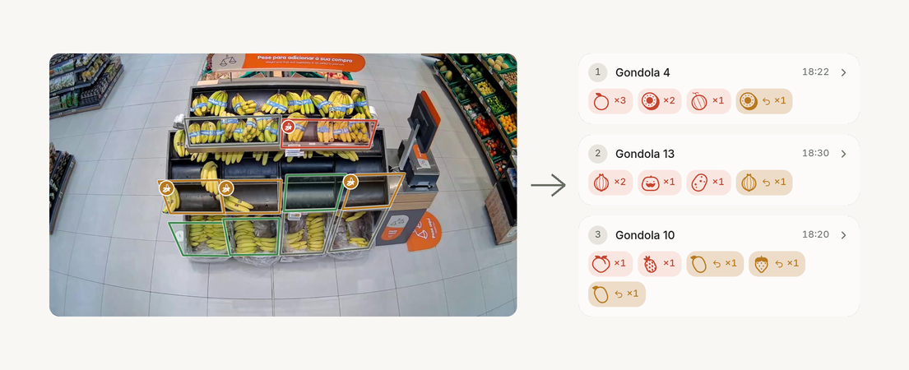
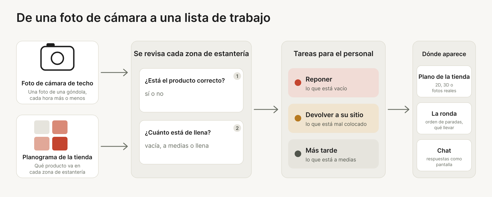
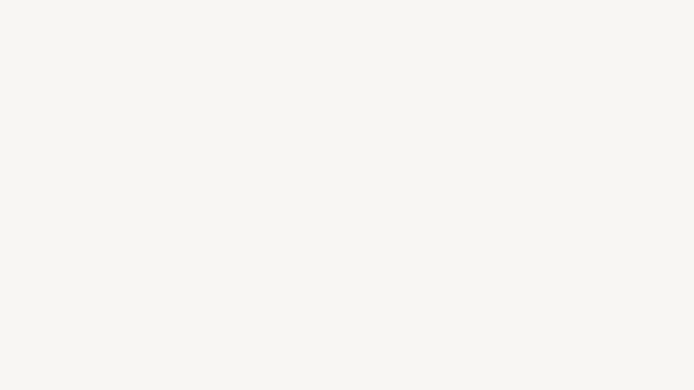

<p align="center">
  
</p>

<h1 align="center">Strivon</h1>

<p align="center">
  <strong>Strivon convierte las fotos de las cámaras de techo de las estanterías de fruta y verdura en una lista de trabajo para el personal de la tienda: qué reponer y qué devolver a su sitio.</strong>
</p>

<p align="center">
  Para una tienda con cámaras de techo y un planograma de estanterías.
</p>

<p align="center">
  <a href="https://strivon-landing.vercel.app"></a>
  <a href="docs/APP.md"></a>
</p>

<p align="center">
  <a href="#ejecutarlo-en-local">Ejecutar en local</a> ·
  <a href="README.md">English</a> · <a href="README.pt.md">Português</a>
</p>

<p align="center">
  
</p>

<p align="center"><sub>Entran fotos de las cámaras de techo, sale una lista de trabajo. Las marcas son las respuestas del modelo para la última foto de cada cámara.</sub></p>

<p align="center"><a href="assets/video/strivon-opening-1080p.mp4"><strong>Ver la apertura de 10 segundos</strong></a> · MP4, 1080p, con sonido y subtítulos</p>

## ¿Qué es Strivon?

La fruta y la verdura son la sección donde más importa el estado de una estantería. Una góndola vacía es una venta perdida, una con exceso acaba en merma y un producto fuera de su sitio se cobra al precio equivocado. Hoy lo comprueba el personal recorriendo la tienda.

Una cámara de techo ya ve cada góndola, pero la fruta suelta y apilada, sin código de barras, es difícil de leer para un ordenador, y los clientes y el personal la tapan con las manos. Strivon toma la foto y el planograma de la tienda y revisa cada zona de estantería: ¿tiene el producto que debe y cuánto está de llena? Lo que sale es una lista de trabajo para el personal.

Se creó en JunctionX Lisboa 2026 para el reto de Sensei, con un día de fotos de 14 cámaras de una tienda autónoma de Leiria. En el conjunto de prueba que nos dio Sensei, una ejecución de un compañero sacó 525 de 578 puntos.

## Cómo funciona

<p align="center">
  
</p>

Para cada zona de estantería de una foto, el pipeline responde dos preguntas y la app convierte las respuestas en tareas.

| Pregunta | Respuesta | Tarea para el personal |
|---|---|---|
| ¿Está el producto correcto? | sí o no | **Devolver a su sitio** si es otro |
| ¿Cuánto está de llena la zona? | vacía, a medias o llena | **Reponer** si está vacía, **Más tarde** si está a medias, nada si está llena |

La app agrupa las tareas por góndola para poder planificar una ronda: el plano marca dónde están los problemas y la lista dice qué llevar a cada parada. El reto puntúa cada zona, así que el pipeline se ajusta a los puntos y también a las tareas: mira [`docs/PLAN.md`](docs/PLAN.md).

## Qué puedes hacer hoy

- **Ver la ronda de toda la tienda**: un plano muestra qué góndolas necesitan algo y una lista da el orden de las paradas y qué llevar a cada una.
- **Abrir una góndola** para ver la foto de su cámara con lo que está mal marcado, y **reproducir el día** con la barra para ver cómo cambian el plano y la lista.
- **Mirar la tienda** como un plano, un modelo 3D o la última foto de cada cámara, con una vista de productos en tarjetas y una página de análisis con la parte del tiempo que las estanterías estuvieron vacías.
- **Preguntarle algo a la tienda** y recibir la respuesta como una pantalla, con gráficas, tareas y tarjetas con foto. Necesita una clave de un modelo en el servidor.
- **Calibrar cada producto**: dos asas en una misma barra fijan dónde acaba lo vacío y dónde empieza lo lleno, de modo que cada tienda decide cuánto stock cuenta ya como lleno. Los niveles del modelo se mantienen hasta que alguien pone un marcador.
- **Comprobar un conjunto de validación**: una página ejecuta el modelo sobre una carpeta de fotos y muestra la puntuación y los porcentajes, y otra compara varios conjuntos. Ver [`docs/VALIDATION_DAY.md`](docs/VALIDATION_DAY.md).
- **Predecir una carpeta de fotos** desde la línea de comandos: un JSON con `planogram_compliant` y `stock_level` para cada zona.
- **Puntuar las predicciones** con nuestras propias etiquetas y los puntos del reto.

> **Estado.** La app muestra las respuestas del modelo cuando encuentra `outputs/predictions.json`, que escribe `agents/predict.py`, y estados de estantería simulados cuando no. La demo de la landing y la imagen principal usan las respuestas del modelo.

## Verlo

La landing está en [strivon-landing.vercel.app](https://strivon-landing.vercel.app).

### La app para el personal

Un plano de la tienda muestra qué góndolas necesitan algo, y la lista de al lado da el orden de la ronda y qué llevar a cada parada.

Reproduce el día para ver cómo cambian los dos, y abre una góndola para ver su estantería con lo que está mal marcado.

### UI generativa

El chat responde con una pantalla. El modelo escribe el diseño de la respuesta con las piezas de la propia app (gráficas, tablas, tareas, un mapa del día, tarjetas con foto) y la app lo dibuja, así que la respuesta se puede abrir y seguir hasta la estantería de la que habla.

Necesita una clave de un modelo en el servidor (`LLM_API_KEY` en `frontend/.env`); sin ella el chat se oculta.

<p align="center">
  
</p>

Los estados de las estanterías en el clip son datos de ejemplo. El [clip completo](assets/video/chat-to-gondola.mp4) y más están en [`assets/video`](assets/video).

## Ejecutarlo en local

La app, con Node 20 o superior:

```bash
cd frontend
npm install
npm run dev
```

Con los datos del reto en `data/`, muestra las fotos y las zonas reales. Sin ellos, dibuja estanterías inventadas.

El pipeline, desde `backend/`. Añade `--no-clip` para saltarte PyTorch y usar solo los rasgos clásicos:

```bash
python -m pip install -r requirements.txt
python -m sensei predict
python -m sensei score
```

Por defecto, `predict` lee `data/images` y escribe `outputs/predictions.json`, y `score` comprueba ese fichero con `eval/labels.json`.

Los pasos del día de la entrega están en [`docs/VALIDATION_DAY.md`](docs/VALIDATION_DAY.md).

## Documentación

Para leer más, mira la carpeta [`docs`](docs): la app, el chat, la puntuación y el día de validación. El diseño de la interfaz está en [`frontend/DESIGN.md`](frontend/DESIGN.md), los resultados en [`LEADERBOARD.md`](LEADERBOARD.md) y las normas para contribuir en [`CONTRIBUTING.md`](CONTRIBUTING.md).

## Código previo

Escrito durante el hackathon, salvo:

- `frontend/src/model/catalog.ts` porta las reglas de familias de producto de `backend/sensei/catalog.py`.
- La interfaz usa React, Vite, Tailwind CSS, shadcn/ui, Base UI, OpenUI, Lucide y
  country-flag-icons, todos MIT. Las versiones están en `frontend/package.json`.

Hecho en JunctionX Lisboa 2026, para el reto de Sensei.

<p align="center">
  
  &nbsp;&nbsp;&nbsp;
  
</p>

El código tiene la [licencia MIT](LICENSE). Las fotos del reto y los logotipos de JunctionX Lisboa y de Sensei no entran en ella y pertenecen a sus propietarios.
