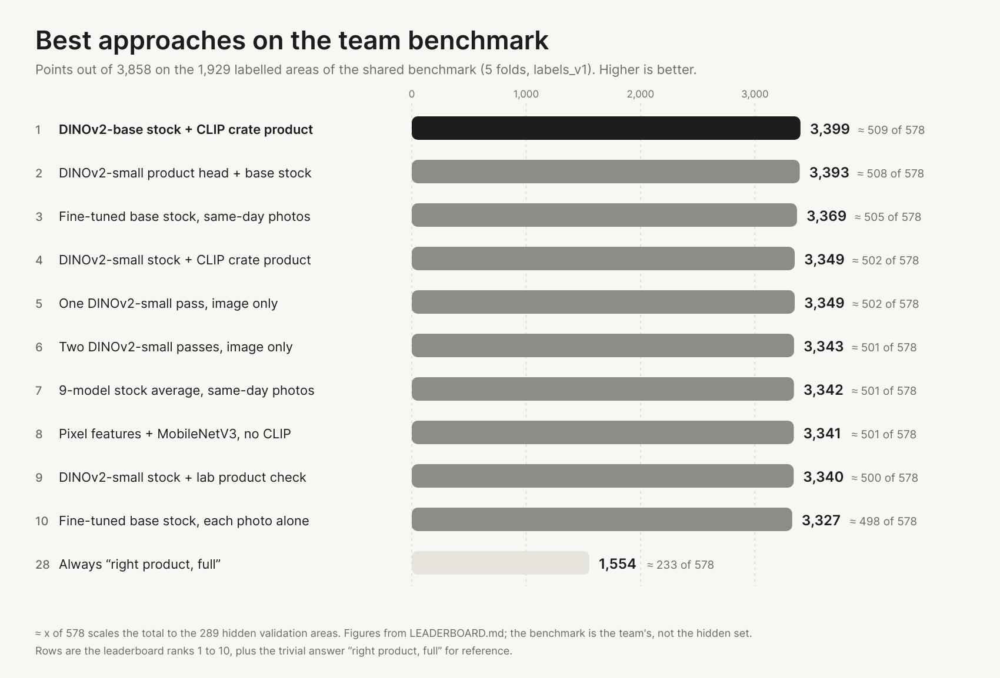

<p align="center">
  
</p>

<h1 align="center">Strivon</h1>

<p align="center">
  <strong>Strivon turns ceiling-camera photos of the fruit and vegetable shelves into a list of work for store staff: what to restock and what to put back.</strong>
</p>

<p align="center">
  For a store with ceiling cameras and a shelf planogram.
</p>

<p align="center">
  <a href="https://strivon-landing.vercel.app"></a>
  <a href="docs/APP.md"></a>
</p>

<p align="center">
  <a href="#run-it-locally">Run locally</a> ·
  <a href="README.es.md">Español</a> ·
  <a href="README.pt.md">Português</a>
</p>

<p align="center">
  
</p>

<p align="center"><sub>Photos from the ceiling cameras in, a list of work out. The marks are the model's answers for the last photo of each camera.</sub></p>

## What is Strivon?

Fresh produce is where the state of a shelf matters most. An empty gondola is a lost sale, an
overstocked one ends in waste, and a product in the wrong place gets the wrong price. Today the
staff check this by walking the store.

A ceiling camera already sees every gondola, but loose, piled fruit with no barcode is hard for a
computer to read, and shoppers and staff hide it with their hands. Strivon takes the photo and the
store's planogram and checks each shelf area: does it hold the product it should, and how full is
it? What comes out is a list of work for the staff.

It was built for the Sensei challenge at JunctionX Lisbon 2026, with a day of photos from 14
cameras in an autonomous store in Leiria.

## How it works

<p align="center">
  
</p>

For every shelf area in a photo, the pipeline answers two questions, and the app turns the answers
into tasks.

| Question | Answer | Task for the staff |
|---|---|---|
| Is the right product there? | yes or no | **Move back** when it is the wrong one |
| How full is the area? | empty, half full or full | **Restock** when empty, **Later** when half full, nothing when full |

The tasks are grouped by gondola so a round can be planned: the plan marks where the problems are,
and the list says what to carry to each stop. The challenge scores every area, so the pipeline is
tuned for those points as well as for the tasks. The scoring is in [`docs/PLAN.md`](docs/PLAN.md).

## What you can do today

- **See the round for the whole store.** A plan shows which gondolas need something, and a list
  gives the order of the stops and what to carry to each one.
- **Open a gondola** to see its camera photo with what is wrong marked, and **play the day** with
  the day bar to watch the plan and the list change.
- **Look at the store** as a plan, a 3D model or the latest photo of each camera. A products page
  has a card for each product, and an insights page shows how much of the time shelves were empty.
- **Ask the store a question** and get the answer as a screen, with charts, tasks and photo cards.
  It needs a model key on the server.
- **Predict a folder of photos** from the command line: one JSON with `planogram_compliant` and
  `stock_level` for every area.
- **Score the predictions** against our labels with the challenge's points.

> **Status.** The app shows the model's answers when it finds `outputs/predictions.json`, which
> `agents/predict.py` writes, and simulated shelf states when it does not. The landing demo and the
> header picture use the model's answers.

## See it

The landing is at [strivon-landing.vercel.app](https://strivon-landing.vercel.app).

### The app for staff

Open the first page and the plan of the store shows which gondolas need something. The list beside
it gives the order of the round and what to bring to each stop. Press a gondola to see its shelf
with what is wrong marked, or play the day to watch both change.

### Generative UI

The chat answers with a screen. The model writes the layout of the answer out of the app's own
parts (charts, tables, tasks, a map of the day, photo cards) and the app draws it, so you can open
the answer and follow it to the shelf it talks about. It needs a model key on the server
(`LLM_API_KEY` in `frontend/.env`); without one the chat is hidden.

<p align="center">
  
</p>

The shelf states in the clip are sample data. The [full clip](assets/video/chat-to-gondola.mp4) and more are in [`assets/video`](assets/video).

## Run it locally

The app, with Node 20 or higher:

```bash
cd frontend
npm install
npm run dev
```

With the challenge data in `data/`, it shows the real photos and shelf areas. Without it, it draws
made-up shelves.

The pipeline, from `backend/`. Add `--no-clip` to skip PyTorch and use the classical features only:

```bash
python -m pip install -r requirements.txt
python -m sensei predict
python -m sensei score
```

By default `predict` reads `data/images` and writes `outputs/predictions.json`, and `score` checks
that file against `eval/labels.json`.

The steps for the day of the submission are in [`docs/VALIDATION_DAY.md`](docs/VALIDATION_DAY.md).

## Documentation

- [`docs/APP.md`](docs/APP.md): what the app shows and the data it reads.
- [`frontend/DESIGN.md`](frontend/DESIGN.md): how the interface looks and the reason for each choice.
- [`docs/PLAN.md`](docs/PLAN.md): how the challenge is scored and the plan to score well.
- [`docs/SENSEI_INFO.md`](docs/SENSEI_INFO.md): what Sensei told us, including what empty, half and full mean.
- [`docs/VALIDATION_DAY.md`](docs/VALIDATION_DAY.md): how to produce the submission.
- [`LEADERBOARD.md`](LEADERBOARD.md): how every approach is scored, and the results.
- [`CONTRIBUTING.md`](CONTRIBUTING.md): branches, commits and language.

## Results

<p align="center">
  
</p>

Every approach is scored the same way on the team benchmark. The rules are in
[LEADERBOARD.md](LEADERBOARD.md), and `python eval/leaderboard.py` refreshes the tables below. The
chart is a snapshot of the top ten, so it ages when the leaderboard changes.

<details>
<summary>Leaderboard</summary>

<!-- LEADERBOARD:START -->
Answer key `labels_v1`: 1929 areas, maximum 3858 points. "≈ /578" scales the total to the 289 hidden validation areas.

| # | Approach | Owner | Labels trained on | Looks at other photos? | Identification | Stock | Total / max | ≈ / 578 | Per area | Last photo, per area | Seconds per photo |
|---:|---|---|---|---|---:|---:|---:|---:|---:|---:|---|
| 1 | Combined: stock from André's fine-tuned DINOv2-base, product check from Miguel's CLIP crate model (`combo_dinob_stock_clip_product`) | André + Miguel | the key | no | +1911 | +1488 | +3399 / 3858 | +509 | +1.762 | +1.675 | about 6.4 CPU (stock 5.6 + product 0.8); stock 0.23 GPU |
| 2 | Agents, image only: product head on frozen DINOv2-small + fine-tuned DINOv2-base stock (2 seeds) (`agents_img_ftB2`) | André (agents) | labels_v1 | no | +1905 | +1488 | +3393 / 3858 | +508 | +1.759 | +1.636 | 6.67 CPU; ≈ 0.26 GPU (from component timings) |
| 3 | Agents' pipeline, fine-tuned DINOv2-base stock (2 seeds), uses same-day photos (`agents_finetuned_b_same_day`) | André (agents) | labels_v1 | yes, same camera and day | +1881 | +1488 | +3369 / 3858 | +505 | +1.747 | +1.675 | ≈ 7 CPU (stock 5.6 + product 1.1–1.6), ≈ 0.4 GPU |
| 4 | Combined, cheap: stock from André's fine-tuned DINOv2-small, product check from Miguel's CLIP crate model (`combo_dinos_stock_clip_product`) | André + Miguel | the key | no | +1911 | +1438 | +3349 / 3858 | +502 | +1.736 | +1.563 | about 1.7 CPU (stock 0.9 + product 0.8) |
| 5 | Agents, image only, ONE DINOv2-small pass: product from frozen block 8, stock from the fine-tuned blocks (`agents_img_one_pass`) | André (agents) | labels_v1 | no | +1911 | +1438 | +3349 / 3858 | +502 | +1.736 | +1.543 | 0.82 CPU (4 threads); GPU being measured |
| 6 | Agents, image only: product head on frozen DINOv2-small + fine-tuned DINOv2-small stock (two passes) (`agents_img_ftS`) | André (agents) | labels_v1 | no | +1905 | +1438 | +3343 / 3858 | +501 | +1.733 | +1.523 | 1.75 CPU; ≈ 0.15 GPU (from component timings) |
| 7 | Agents' pipeline, 9-model stock average, uses same-day photos (`agents_9models_same_day`) | André (agents) | labels_v1 | yes, same camera and day | +1881 | +1461 | +3342 / 3858 | +501 | +1.733 | +1.623 | stock ≈ 2.4 GPU (2.6 GB VRAM) or up to ≈ 195 CPU, plus the product check |
| 8 | Single image, no CLIP: weighted average of three lab stock models (pixel features, slot references, a small fine-tuned MobileNetV3) + product check against a bank of training crops, colours balanced per crop (the shipped model, `python lab/predict.py`) (`lab_image_only_ensemble`) | Jose (lab) | the key | training crops only | +1893 | +1448 | +3341 / 3858 | +501 | +1.732 | +1.424 | 0.11 CPU per photo (1 thread, warm); 0.12 per photo over a batch of 28 including a 0.3 startup (`python lab/predict_fast.py`); i7 laptop, no GPU |
| 9 | Combined, cheaper: stock from André's fine-tuned DINOv2-small, product check from the lab's image-only model (HSV bank of training crops) (`combo_dinos_stock_lab_product`) | André + Jose (lab) | the key | training crops only | +1902 | +1438 | +3340 / 3858 | +500 | +1.731 | +1.523 | about 0.9 CPU (stock 0.9 + product 0.01, product measured on a loaded machine) |
| 10 | Agents' pipeline, fine-tuned DINOv2-base stock (2 seeds), each photo on its own (`agents_finetuned_b_single_photo`) | André (agents) | labels_v1 | no | +1839 | +1488 | +3327 / 3858 | +498 | +1.725 | +1.675 | ≈ 8.7 CPU (stock 5.6 + product 3.05); stock 0.23 GPU |
| 11 | Combined: stock = the lower of Miguel's CLIP crate model and José's lab ensemble, product check from the CLIP crate model (`combo_min_crate_lab`) | Miguel + José | the key | no | +1911 | +1413 | +3324 / 3858 | +498 | +1.723 | +1.470 | about 1.1-1.5 CPU (0.9-1.4 + 0.14) |
| 12 | Agents' pipeline, fine-tuned DINOv2-small stock, uses same-day photos (`agents_finetuned_s_same_day`) | André (agents) | labels_v1 | yes, same camera and day | +1881 | +1438 | +3319 / 3858 | +497 | +1.721 | +1.563 | ≈ 2–2.5 CPU (stock 0.9 + product 1.1–1.6), ≈ 0.3 GPU |
| 13 | Single image: pixel features of the area and its crate + logistic and tree blend, product check against a bank of training crops (`lab_image_only`) | Jose (lab) | the key | training crops only | +1902 | +1404 | +3306 / 3858 | +495 | +1.714 | +1.377 | being measured; features about 0.1 s per photo on 1 CPU thread (partial), no GPU, no CLIP |
| 14 | Agents' pipeline, 9-model stock average, each photo on its own (`agents_9models_single_photo`) | André (agents) | labels_v1 | no | +1839 | +1461 | +3300 / 3858 | +494 | +1.711 | +1.623 | stock ≈ 2.4 GPU (2.6 GB VRAM) or up to ≈ 195 CPU, plus the product check |
| 15 | Agents, image only: frozen DINOv2-small with a product head and a stock head (`agents_img_frozen_S`) | André (agents) | labels_v1 | no | +1905 | +1380 | +3285 / 3858 | +492 | +1.703 | +1.543 | 0.83 CPU; ≈ 0.12 GPU (from component timings) |
| 16 | Agents' pipeline, fine-tuned DINOv2-small stock, each photo on its own (`agents_finetuned_s_single_photo`) | André (agents) | labels_v1 | no | +1839 | +1438 | +3277 / 3858 | +491 | +1.699 | +1.563 | ≈ 4 CPU (stock 0.9 + product 3.05); stock 0.12 GPU |
| 17 | Agents' pipeline + 3rd stock head, uses same-day photos (`agents_same_day_3heads`) | André (agents) | labels_v1 | yes, same camera and day | +1881 | +1389 | +3270 / 3858 | +490 | +1.695 | +1.503 | 2.34 CPU (+ up to 0.6), 0.17 GPU |
| 18 | Single image: CLIP ViT-B-32 on the hand-drawn crate + colour + area id, logistic regression (`single_crate`) | Miguel (crates by Jose) | the key | no | +1911 | +1344 | +3255 / 3858 | +488 | +1.687 | +1.457 | 0.9-1.4 s, 2-8 CPU threads (laptop), no GPU |
| 19 | Single image: CLIP ViT-B-32 + colour + area id, logistic regression + gradient boosting blend (`single_blend_vitb32`) | Miguel | the key | no | +1905 | +1348 | +3253 / 3858 | +487 | +1.686 | +1.589 | 0.8-1.3 s, 2 CPU threads (laptop), no GPU |
| 20 | Agents' pipeline, uses same-day photos (`agents_same_day`) | André (agents) | labels_v1 | yes, same camera and day | +1881 | +1371 | +3252 / 3858 | +487 | +1.686 | +1.543 | 2.34 CPU, 0.17 GPU |
| 21 | Agents' pipeline + 3rd stock head, each photo on its own (`agents_single_photo_3heads`) | André (agents) | labels_v1 | no | +1839 | +1385 | +3224 / 3858 | +483 | +1.671 | +1.483 | 3.44 CPU (+ up to 0.6), 0.21 GPU |
| 22 | Single image + labelled training crops of the same area as references (`single_ref_vitb16`) | Miguel | the key | training crops only | +1905 | +1313 | +3218 / 3858 | +482 | +1.668 | +1.510 | about 3 s, 20 CPU threads (laptop) |
| 23 | Single image: CLIP ViT-B-16 + colour + area id, logistic regression (`single_vitb16`) | Miguel | the key | no | +1896 | +1315 | +3211 / 3858 | +481 | +1.665 | +1.503 | about 3 s, 20 CPU threads (laptop) |
| 24 | Single image: CLIP ViT-B-32 + colour + area id, logistic regression (`single_vitb32`) | Miguel | the key | no | +1908 | +1297 | +3205 / 3858 | +480 | +1.661 | +1.543 | 0.8 s, 2 CPU threads (laptop), no GPU |
| 25 | Agents' pipeline, each photo on its own (`agents_single_photo`) | André (agents) | labels_v1 | no | +1839 | +1351 | +3190 / 3858 | +478 | +1.654 | +1.457 | 3.44 CPU, 0.21 GPU |
| 26 | Agents' pipeline, uses same-day photos (`agents_same_day_andre_labels`) | André (agents) | André's 511 + AI pre-labels | yes, same camera and day | +1860 | +1011 | +2871 / 3858 | +430 | +1.488 | +1.146 | 2.34 CPU, 0.17 GPU |
| 27 | Agents' pipeline, each photo on its own (`agents_single_photo_andre_labels`) | André (agents) | André's 511 + AI pre-labels | no | +1839 | +1019 | +2858 / 3858 | +428 | +1.482 | +1.126 | 3.44 CPU, 0.21 GPU |
| 28 | Always "right product, full" (`baseline`) |  | none | no | +1653 | -99 | +1554 / 3858 | +233 | +0.806 | +0.344 | 0 |
<!-- LEADERBOARD:END -->

</details>

<details>
<summary>Forward split, closest to the hidden set</summary>

<!-- FORWARD:START -->
Forward split: trained without each camera's last 2 photos, tested on them (302 areas). Since `labels_v1` was frozen, 33 of these areas changed in `eval/labels.json`, most of them in André's review of the evening photos where his model disagreed with the labels (PR #61, #75). So `labels_v1` is stale there and the current labels lean towards his models. The table is sorted by the 269 areas where both keys agree, which no review touched. Files in `eval/benchmark/preds_forward/`, scored with `python eval/benchmark.py forward <file>` (all three keys).

| # | Approach | Unchanged areas: total / max | Per area | ≈ / 578 | Identification | Stock | Below | Above | `labels_v1`: total / 604 | Current labels: total / 604 | Seconds per photo |
|---:|---|---:|---:|---:|---:|---:|---:|---:|---:|---:|---|
| 1 | Agents' FINAL model R3, the submission's recipe (`agents/predict.py`): one-pass DINOv2-S retrained on newer labels + block-8 stock head, seed 0 (`agents_R3_s0`) | +494 / 538 | +1.836 | +531 | +269 | +225 | 4 | 8 | +450 | +539 | 2.0 CPU s per photo end to end at 1 thread (28 photos, 6.6 s start-up included; Miguel's laptop, Core Ultra 7 155H); 0.74-0.82 wall at 4 threads (André's laptop); 0.06 GPU |
| 2 | Agents' FINAL model R3, the submission's recipe (`agents/predict.py`): one-pass DINOv2-S retrained on newer labels + block-8 stock head, seed 1 (`agents_R3_s1`) | +483 / 538 | +1.796 | +519 | +269 | +214 | 5 | 10 | +441 | +524 | 2.0 CPU s per photo end to end at 1 thread (28 photos, 6.6 s start-up included; Miguel's laptop, Core Ultra 7 155H); 0.74-0.82 wall at 4 threads (André's laptop); 0.06 GPU |
| 3 | Rule fixed in advance, not adopted: stock = best expected points on the average of the CLIP crate, lab and R3 (seed 0) probabilities, product check from R3 (`combo_avg_crate_lab_R3`) | +481 / 538 | +1.788 | +517 | +269 | +212 | 3 | 12 | +452 | +507 | about 1.8-2.3 wall (R3 0.8 + crate 0.9-1.4 + lab 0.12), from component timings |
| 4 | Rule fixed in advance, not adopted: stock = the lower of the CLIP crate model and R3 (seed 0), product check from R3 (`combo_min_crate_R3`) | +476 / 538 | +1.770 | +511 | +269 | +207 | 14 | 5 | +456 | +507 | about 1.7-2.2 wall (R3 0.8 + crate 0.9-1.4), from component timings |
| 5 | Rule fixed in advance, not adopted: stock = the lower of the CLIP crate model and the best expected points on the average of lab and R3 (seed 0), product check from R3 (`combo_min_crate_avg_lab_R3`) | +469 / 538 | +1.743 | +504 | +269 | +200 | 15 | 6 | +458 | +488 | about 1.8-2.3 wall (R3 0.8 + crate 0.9-1.4 + lab 0.12), from component timings |
| 6 | Agents' one-pass DINOv2-S, round-1 pick, seed 0 (`agents_R0_shipped_s0`) | +464 / 538 | +1.725 | +498 | +269 | +195 | 14 | 8 | +435 | +500 | 0.82 CPU, 0.06 GPU |
| 7 | Agents' one-pass DINOv2-S, round-1 pick, seed 1 (`agents_R0_shipped_s1`) | +464 / 538 | +1.725 | +498 | +269 | +195 | 6 | 14 | +438 | +489 | 0.82 CPU, 0.06 GPU |
| 8 | Combined: stock = the lower of Miguel's CLIP crate model and José's lab ensemble, product check from the CLIP crate model (`combo_min_crate_lab`) | +458 / 538 | +1.703 | +492 | +269 | +189 | 16 | 8 | +452 | +472 | about 1.1-1.5 CPU (0.9-1.4 + 0.14) |
| 9 | Single image, no CLIP: weighted average of three lab stock models (pixel features, slot references, a small fine-tuned MobileNetV3) + product check against a bank of training crops, colours balanced per crop (the shipped model, `python lab/predict.py`) (`lab_image_only_ensemble`) | +453 / 538 | +1.684 | +487 | +266 | +187 | 6 | 16 | +423 | +481 | 0.11 CPU per photo (1 thread, warm); 0.12 per photo over a batch of 28 including a 0.3 startup (`python lab/predict_fast.py`); i7 laptop, no GPU |
| 10 | Single image: CLIP ViT-B-32 on the hand-drawn crate + colour + area id, logistic regression (`single_crate`) | +447 / 538 | +1.662 | +480 | +269 | +178 | 13 | 13 | +437 | +457 | 0.9-1.4 s, 2-8 CPU threads (laptop), no GPU |
| 11 | Agents' LABEL-FREE line, zero labels (`agents/predict.py --label-free`, U7): SigLIP2 zero-shot product check + stock from the share of 3×3 crate regions that look like empty floor (ONE 336 px pass per crate, regions MAP-pooled), against a per-area baseline built from unlabelled photos (here: the forward split's training photos only) (`agents_labelfree_U7`) | +275 / 538 | +1.022 | +295 | +260 | +15 | 10 | 56 | +240 | +262 | 7.3-9.5 CPU s per photo (4 threads), 0.18-0.38 GPU (RTX 3060 laptop) |
| 12 | Agents' LABEL-FREE line, zero labels, earlier version U6 (replaced by U7): SigLIP2 zero-shot product check + stock from the share of 3×3 crate tiles that look like empty floor (9 tile passes), against a per-area baseline built from unlabelled photos (here: the forward split's training photos only) (`agents_labelfree_U6`) | +225 / 538 | +0.836 | +242 | +260 | -35 | 16 | 64 | +184 | +224 | ~22 CPU s per photo (4 threads), 0.4-1.3 GPU (RTX 3060 laptop) |
<!-- FORWARD:END -->

</details>

## Prior code

Written during the hackathon, except:

- `frontend/src/model/catalog.ts` ports the product family rules of `backend/sensei/catalog.py`.
- The models start from pretrained weights and libraries we did not write: DINOv2 (R3), CLIP (the backend crate model), SigLIP2 (the label-free mode) and MobileNetV3-small through `timm` (the lab model), on top of PyTorch, timm, NumPy, OpenCV and scikit-learn. The code that fine-tunes, fits and combines them was written here.
- The interface uses React, Vite, Tailwind CSS, shadcn/ui, Base UI, OpenUI, Lucide and
  country-flag-icons, all MIT. Versions are in `frontend/package.json`.

Built at JunctionX Lisbon 2026, for the Sensei challenge.

<p align="center">
  
  &nbsp;&nbsp;&nbsp;
  
</p>

The code is under the [MIT license](LICENSE). The challenge photos and the JunctionX Lisbon and Sensei logos are not covered by it and belong to their owners.
