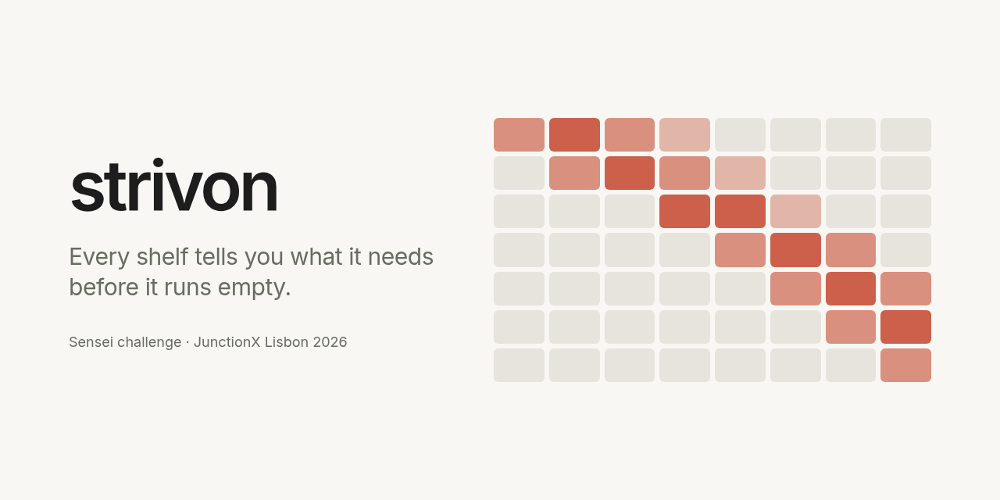

  

Strivon checks each shelf area from a ceiling camera and the store planogram: is it holding the
right product, and how full is it? Store staff get what to restock and what to move back.

## Layout

- `backend/` the pipeline that writes the predictions, and the server.
- `frontend/` the web for store staff.
- `eval/` and `annotations/` scoring and our own labels.
- `docs/` plan, tasks and notes.
- `data/` and `outputs/` challenge images and predictions. Not committed.

## Prior code

Written during the hackathon, except:

- `frontend/src/model/catalog.ts` ports the product family rules of `backend/sensei/catalog.py`.
- The interface uses React, Vite, Tailwind CSS, shadcn/ui, Base UI, OpenUI, Lucide and
  country-flag-icons, all MIT. Versions are in `frontend/package.json`.

&nbsp;&nbsp;&nbsp;

Built at JunctionX Lisbon 2026 for the Sensei challenge. The logos belong to their owners.
