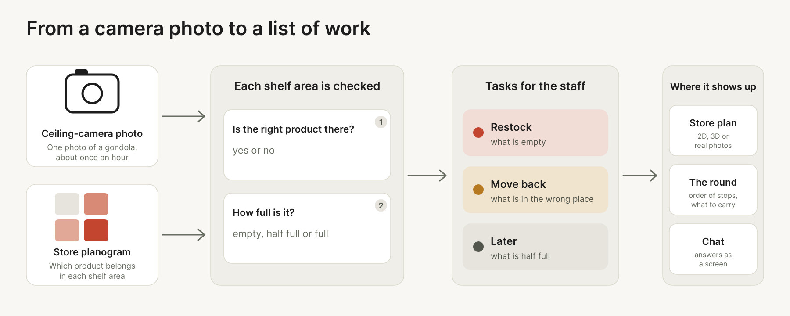

<p align="center">
  
</p>

<h1 align="center">Strivon</h1>

<p align="center">
  <strong>O Strivon transforma as fotografias das câmaras de teto das prateleiras de fruta e legumes numa lista de trabalho para os funcionários da loja: o que repor e o que devolver ao seu lugar.</strong>
</p>

<p align="center">
  Para uma loja com câmaras de teto e um planograma das prateleiras.
</p>

<p align="center">
  <a href="https://strivon-landing.vercel.app"></a>
  <a href="docs/APP.md"></a>
</p>

<p align="center">
  <a href="#executar-localmente">Executar localmente</a> ·
  <a href="README.md">English</a> · <a href="README.es.md">Español</a>
</p>

<p align="center">
  
</p>

<p align="center"><sub>Entram fotografias das câmaras de teto, sai uma lista de trabalho. As marcas são as respostas do modelo para a última fotografia de cada câmara.</sub></p>

## O que é o Strivon?

A fruta e os legumes são a secção onde o estado de uma prateleira mais importa. Uma gôndola vazia é uma venda perdida, uma com excesso acaba em desperdício e um produto fora do lugar é cobrado ao preço errado. Hoje, a equipa verifica isto percorrendo a loja.

Uma câmara de teto já vê cada gôndola, mas a fruta solta e empilhada, sem código de barras, é difícil de ler para um computador, e os clientes e a equipa tapam-na com as mãos. O Strivon recebe a fotografia e o planograma da loja e verifica cada zona da prateleira: tem o produto que deve ter e quão cheia está? O resultado é uma lista de trabalho para a equipa.

Foi criado no JunctionX Lisboa 2026 para o desafio da Sensei, com um dia de fotografias de 14 câmaras de uma loja autónoma em Leiria. Ficámos em terceiro lugar no desafio da Sensei. No conjunto de teste que a Sensei nos deu, o nosso modelo fez 525 de 578 pontos.

## Como funciona

<p align="center">
  
</p>

Para cada zona de prateleira numa fotografia, o pipeline responde a duas perguntas e a aplicação transforma as respostas em tarefas.

| Pergunta | Resposta | Tarefa para os funcionários |
|---|---|---|
| Está lá o produto certo? | sim ou não | **Devolver ao lugar** se for outro |
| Quão cheia está a zona? | vazia, a meio ou cheia | **Repor** se estiver vazia, **Mais tarde** se estiver a meio, nada se estiver cheia |

A aplicação agrupa as tarefas por gôndola para se poder planear uma ronda: o plano assinala onde estão os problemas e a lista diz o que levar a cada paragem. O desafio pontua cada zona, por isso o pipeline é afinado para os pontos e também para as tarefas: ver [`docs/PLAN.md`](docs/PLAN.md).

## O que pode fazer hoje

- **Ver a ronda** de toda a loja: que gôndolas precisam de algo, por que ordem e o que levar.
- **Abrir uma gôndola** para ver a sua fotografia com o que está mal assinalado, e **reproduzir o dia** para a ver mudar.
- **Olhar para a loja** como plano, modelo 3D ou fotografias, por produto ou na página de análise.
- **Fazer uma pergunta à loja** e receber um ecrã. Precisa de uma chave de um modelo no servidor.
- **Calibrar cada produto**: duas pegas definem onde acaba o vazio e onde começa o cheio.
- **Verificar um conjunto de validação**, ver [`docs/VALIDATION_DAY.md`](docs/VALIDATION_DAY.md).
- **Prever e pontuar uma pasta de fotografias** a partir da linha de comandos.

> **Estado.** Sem `outputs/predictions.json`, que o `agents/predict.py` escreve, a aplicação mostra prateleiras simuladas.

## Ver

A landing page está em [strivon-landing.vercel.app](https://strivon-landing.vercel.app).

### A aplicação para os funcionários

Um plano da loja mostra que gôndolas precisam de algo, e a lista ao lado dá a ordem da ronda e o que levar a cada paragem.

Reproduza o dia para ver os dois mudarem e abra uma gôndola para ver a sua prateleira com o que está mal assinalado.

### UI generativa

O chat responde com um ecrã, construído com o [OpenUI](https://www.openui.com). O modelo escreve o desenho da resposta, na linguagem do OpenUI, com as peças da própria aplicação (gráficos, tabelas, tarefas, um mapa do dia, cartões com fotografia) e a aplicação desenha-o, por isso a resposta pode ser aberta e seguida até à prateleira de que fala.

Precisa de uma chave de um modelo no servidor (`LLM_API_KEY` em `frontend/.env`); sem ela o chat fica escondido.

<p align="center">
  
</p>

Os estados das prateleiras no clipe são dados de exemplo. O [clipe completo](assets/video/chat-walk.mp4) e mais estão em [`assets/video`](assets/video).

## Executar localmente

A aplicação, com Node 20 ou superior:

```bash
cd frontend
npm install
npm run dev
```

Com os dados do desafio em `data/`, mostra as fotografias e as zonas reais. Sem eles, desenha prateleiras inventadas.

O pipeline, a partir de `backend/`. Acrescente `--no-clip` para dispensar o PyTorch e usar só as características clássicas:

```bash
python -m pip install -r requirements.txt
python -m sensei predict
python -m sensei score
```

Por defeito, `predict` lê `data/images` e escreve `outputs/predictions.json`, e `score` confere esse ficheiro com `eval/labels.json`.

Os passos do dia da entrega estão em [`docs/VALIDATION_DAY.md`](docs/VALIDATION_DAY.md).

## Documentação

Para ler mais, vê a pasta [`docs`](docs): a aplicação, o chat, a pontuação e o dia de validação. O desenho da interface está em [`frontend/DESIGN.md`](frontend/DESIGN.md), os resultados em [`LEADERBOARD.md`](LEADERBOARD.md) e as regras para contribuir em [`CONTRIBUTING.md`](CONTRIBUTING.md).

## Código anterior

Escrito durante o hackathon, exceto:

- `frontend/src/model/catalog.ts` porta as regras de famílias de produto de `backend/sensei/catalog.py`.
- A interface usa React, Vite, Tailwind CSS, shadcn/ui, Base UI, OpenUI, Lucide e
  country-flag-icons, todos MIT. As versões estão em `frontend/package.json`.

Feito no JunctionX Lisboa 2026, para o desafio da Sensei.

<p align="center">
  
  &nbsp;&nbsp;&nbsp;
  
</p>

O código tem a [licença MIT](LICENSE). As fotografias do desafio e os logótipos do JunctionX Lisboa e da Sensei não estão incluídos nela e pertencem aos seus proprietários.
